# Aegis Identity — User & Hierarchy Management System (CZ / SK)

[](LICENSE)
[](https://work2survive.github.io/aegis-user-management-system/)
[](https://github.com/work2survive/aegis-user-management-system)
[](#-technical-architecture)

> 🚀 **Live Interactive Demo**: [https://work2survive.github.io/aegis-user-management-system/](https://work2survive.github.io/aegis-user-management-system/)  
> *(No build steps or dependencies required — runs directly in modern web browsers)*

---

## 📋 Table of Contents

- [Overview](#-overview)
- [Key Features & Implemented Rules](#-key-features--implemented-rules)
- [Group Roles & Codename Registry](#-group-roles--codename-registry)
- [Granular Privilege Matrix](#-granular-privilege-matrix)
- [RCS Business Messaging Matrix](#-rcs-business-messaging-matrix)
- [Institutional Hierarchy (CZ & SK)](#-institutional-hierarchy-cz--sk)
- [Floating Testing Simulator](#-floating-testing-simulator)
- [Dynamic Rebranding & Theming](#-dynamic-rebranding--theming)
- [Technical Architecture](#-technical-architecture)
- [Quick Start & Local Development](#-quick-start--local-development)
- [CSV / XLS Roster Ingestion Format](#-csv--xls-roster-ingestion-format)
- [License](#-license)

---

## 💡 Overview

**Aegis Identity** is a client-side User, Role, and Territorial Hierarchy management system tailored for educational and public-sector institutions across the **Czech Republic** (🇨🇿) and the **Slovak Republic** (🇸🇰).

The platform simulates multi-tenant administrative boundaries, role-based access control (RBAC), privacy safeguards, batch user provisioning, and an interactive Rich Communication Suite (RCS) messaging gateway.

```
 ┌─────────────────────────────────────────────────────────────────────────────┐
 │ 🛡️ Aegis Identity Core (Header Bar)                                          │
 │ [Avatar] Jan Novák  •  NEXUS-OMNI  •  🇨🇿 CZ / Praha / CUNI / MFF             │
 │ [👁️⃤ God Mode]   [🧪 Switch Persona]   [🎨 Rebrand]   [☀️/🌙 Theme]        │
 ├─────────────────────────────────────────────────────────────────────────────┤
 │ ⚠️ Scope Banner: Active Purview: Global (Unrestricted)                      │
 ├─────────────────────────────────────────────────────────────────────────────┤
 │ [👥 Users (300)]  [🛡️ Groups (20)]  [🏛️ Hierarchy (53)]  [💬 RCS]  [📊 Audit] │
 ├─────────────────────────────────────────────────────────────────────────────┤
 │                                                                             │
 │  ┌─────────────────────────────────────────────────┐   ┌─────────────────┐ │
 │  │ Users Table / Group Cards / Hierarchy Tree      │   │ ⚠️ TEST PANEL   │ │
 │  │                                                 │   │ Jan Novák       │ │
 │  │  • Mandatory Phone: +420 / +421 Unified         │   │ [God Mode]      │ │
 │  │  • Privacy Protection: ••••••• [Restricted]     │   │ [Switch User]   │ │
 │  │  • Bulk Edit & CSV/XLS Import                   │   │ [Random User]   │ │
 │  │  • Duplicate Privilege Prevention               │   │ (Draggable ⠿)   │ │
 │  └─────────────────────────────────────────────────┘   └─────────────────┘ │
 └─────────────────────────────────────────────────────────────────────────────┘
```

---

## ⚡ Key Features & Implemented Rules

### 1. Mandatory Unified Phone Number Format (Rule 0.0)
- **Strict Format Requirement**: Every user must possess an international phone number formatted strictly with the country area code:
  - **Czech Republic**: `+420 XXX XXX XXX` (e.g. `+420 777 123 456`)
  - **Slovakia**: `+421 XXX XXX XXX` (e.g. `+421 905 123 456`)
- **Real-Time Input Masking**: Auto-formats 3-3-3 digit groupings as user types and automatically strips invalid characters.
- **Form & CSV Validation**: Prevents saving users or importing rosters that violate the mandatory unified standard.

### 2. Group Management & Duplicate Protection (Rules 1.0 – 1.1)
- Create, rename, edit, disable, and delete security groups.
- **Duplicate Privilege Detection**: The system computes a canonical cryptographic signature of all granted capabilities. If a newly created or edited group matches the exact permissions of an existing group, creation is **blocked** with an explicit warning to maintain non-redundant access control policies.
- **Smart Auto-Naming & Codename Generator**: Live suggestion button analyzes selected permissions and territory to propose descriptive titles (e.g. `Czech Regional Education Supervisor [Level 2]`) and military-grade operational codenames (e.g. `BOHEMIA-INSP-391`).

### 3. Scoped User Management (Rules 2.0 – 2.1)
- **Territorial & Institutional Scoping (Rule 5)**: When logged in as a scoped user (e.g. a Slovak supervisor), all user tables and group lists automatically filter out Czech records, preventing unauthorized cross-jurisdiction access.
- **Granular Permissions**: Individual toggles for Create, Edit, Disable, and Delete users.
- **Bulk User Operations (Rule 3.1)**: Multi-select rows to batch-update status (`Active`, `Inactive`, `Suspended`), reassign group memberships, or transfer across organizations.
- **CSV & XLS Roster Ingestion (Rule 3.2)**: Drag-and-drop batch import with client-side row-by-row error detection and pre-formatted CSV template download.

### 4. Privacy Shields & Credential Lifecycle (Rules 6.0 – 6.7)
- **Privacy Gating (Rule 6.0)**: Date of birth, residential address, national ID (*rodné číslo*), and emergency contacts are masked as `••••••••••••• [Restricted]` unless the viewer possesses the `view_others_personal` privilege.
- **Self vs. Others Editing (Rules 6.2 – 6.3)**: Separate privileges control editing one's own profile vs. modifying other records.
- **Password Strength Evaluation (Rule 6.5 – 6.6)**: Real-time entropy evaluation checking length, uppercase, numbers, and special symbols.
- **Cryptographic Generator (Rule 6.6)**: Generates 16-character alphanumeric passwords via `crypto.getRandomValues`.
- **RCS Password Recovery (Rule 6.7)**: Simulates a one-time OTP recovery code sent directly to the user's mandatory phone number.

### 5. Institutional & Territorial Hierarchy (Rules 4.0 – 4.2)
- Add, edit, disable, and remove nodes across 3 institutional tiers:
  - **Regions**: Administrative regional entities (e.g. *Hlavní město Praha*, *Bratislavský kraj*).
  - **Organizations**: Universities, high schools, and regional school boards (e.g. *Univerzita Karlova*, *STU v Bratislave*).
  - **Sub-Organizations**: Academic faculties and departments (e.g. *MFF*, *FIIT*, *1LF*).

---

## 🛡️ Group Roles & Codename Registry

The system boots pre-seeded with **20 specialized groups** representing diverse institutional personas:

| # | Group Name | Codename | Category | Territorial Scope | Key Responsibilities |
|---|------------|----------|----------|-------------------|----------------------|
| 1 | **Super Administrators (God Mode)** | `NEXUS-OMNI` | Super Users | 🌐 Global | Full unrestricted access to all entities, groups, and RCS channels. |
| 2 | **National Education Supervisors (Level 3)** | `AURA-GOV` | Supervisors | 🌐 Global | Cross-border ministry inspectors for Czechia and Slovakia. |
| 3 | **Czech Regional Education Supervisors (Level 2)** | `BOHEMIA-INSP` | Supervisors | 🇨🇿 Czech Republic | School district inspectors within Czech territories. |
| 4 | **Slovak Regional Education Supervisors (Level 2)** | `TATRA-INSP` | Supervisors | 🇸🇰 Slovakia | School district inspectors strictly within Slovak territories. |
| 5 | **District Academic Supervisors (Level 1)** | `VANGUARD-L1` | Supervisors | 🇨🇿 Prague Region | Metropolitan Prague evaluators. |
| 6 | **School Principals & Directors** | `RECTOR-EXEC` | Schools | 🌐 Global / Assigned Org | Full school administration, user provisioning, and emergency alerts. |
| 7 | **Senior Academic Faculty & Head Teachers** | `FACULTY-SR` | Teachers | 🌐 Global / Assigned Org | Senior professors managing curricula, bulk grading, and class notices. |
| 8 | **Certified Teachers & Instructors** | `PEDAGOG-STD` | Teachers | 🌐 Global / Assigned Org | Classroom educators with access to attendance reminders and grade alerts. |
| 9 | **Charles University Faculty Lecturers** | `CUNI-DOCENT` | Teachers | 🇨🇿 CUNI (Prague) | Restricted strictly to Charles University departments. |
| 10 | **STU Bratislava Technical Lecturers** | `STU-DOCENT` | Teachers | 🇸🇰 STU (Bratislava) | Restricted strictly to Slovak Technical University faculties. |
| 11 | **Alumni Chapter Presidents & Officers** | `ALUMNI-CHAIR` | Alumni | 🌐 Global | Graduate networking, fundraising, and alumni gala messaging. |
| 12 | **Registered Alumni Network** | `ALUMNI-VERIFIED` | Alumni | 🌐 Global | Standard alumni maintaining profiles and receiving newsletters. |
| 13 | **QA Simulation Test Leads** | `TESTER-ALPHA` | Testers | 🌐 Global | Test coordinators simulating multi-role institutional transitions. |
| 14 | **Automated Sandbox Testers** | `TESTER-SANDBOX` | Testers | 🇨🇿 ČVUT FIT | Automated regression bots restricted to ČVUT computer science. |
| 15 | **Regional IT Operations Administrators** | `SYSADMIN-CORP` | Super Users | 🌐 Global | Account provisioning, CSV imports, and password resets. |
| 16 | **Admissions & Registrar Officers** | `REGISTRAR-OFFICE` | Schools | 🌐 Global | Prospective student batch imports and enrollment records. |
| 17 | **Student Council Representatives** | `STUDENT-SENATE` | Schools | 🌐 Global | Student leadership broadcasting campus event invitations. |
| 18 | **Bursars & Tuition Finance Staff** | `FIN-BURSAR` | Schools | 🌐 Global | Tuition invoices, dorm billing notices, and scholarship announcements. |
| 19 | **Košice Gymnasium Staff & Tutors** | `KOSICE-GYM-FACULTY` | Schools | 🇸🇰 Gymnázium Poštová | Secondary school educators restricted strictly to Košice. |
| 20 | **Campus Safety & Emergency Dispatchers** | `DISPATCH-CENTRAL` | Super Users | 🌐 Global | High-priority emergency RCS broadcast operators. |

---

## 🔐 Granular Privilege Matrix

Each role possesses a granular configuration across **5 privilege domains**:

```mermaid
graph TD
    A[Role Group Privileges] --> B[Group Mgmt]
    A --> C[User Mgmt]
    A --> D[Hierarchy Mgmt]
    A --> E[Personal Info & Password]
    A --> F[RCS Messaging Gateway]

    B --> B1[Create Group]
    B --> B2[Edit / Rename Group]
    B --> B3[Disable Group]
    B --> B4[Delete Group]

    C --> C1[Create User]
    C --> C2[Edit User]
    C --> C3[Disable User]
    C --> C4[Delete User]
    C --> C5[Bulk Edit Users]
    C --> C6[Import XLS / CSV]

    D --> D1[Manage Regions]
    D --> D2[Manage Organizations]
    D --> D3[Manage Sub-organizations]

    E --> E1[View Others' Personal Info]
    E --> E2[Edit Others' Personal Info]
    E --> E3[Edit Own Personal Info]
    E --> E4[Change Password]
    E --> E5[Choose or Generate Password]
    E --> E6[Retrieve Forgotten Password]

    F --> F1[Trigger RCS: All or >=1 of 10 Types]
    F --> F2[Receive RCS: All or >=1 of 10 Types]
```



---

## 💬 RCS Business Messaging Matrix

Under **Rules 7.0 & 8.0**, groups can be authorized to trigger or receive RCS messages across **10 standardized categories**.  
*(Rule requirement: If RCS is permitted, either "All Categories" or at least 1 specific category must be explicitly enabled; empty selections are disallowed).*

| ID | Category Name | Classification | Typical Use Case (CZ / SK Context) |
|----|---------------|----------------|-------------------------------------|
| `rcs-emergency` | **Emergency Alert** | Critical | Evacuations, extreme weather campus shutdowns, civil defense notices. |
| `rcs-security-otp` | **Security & OTP Verification** | Security | Two-factor authentication, password reset verifications. |
| `rcs-sys-notice` | **System Notification** | System | Scheduled platform maintenance, outage warnings, account status alerts. |
| `rcs-attendance` | **Attendance Reminder** | Operations | Daily student check-ins, unexcused absence alerts sent to parents. |
| `rcs-grade-report` | **Grade & Report Update** | Academic | Mid-term evaluations, state exam (*Maturita* / *Státnice*) results. |
| `rcs-calendar-notice` | **Schedule & Calendar Notice** | Academic | Lecture hall reassignments, exam schedule publications. |
| `rcs-admin-memo` | **Administrative Memo** | Administrative | Dean directives, rectorate decrees, compliance deadlines. |
| `rcs-billing-fee` | **Billing & Fee Notice** | Finance | Tuition invoices, dormitory rent reminders, scholarship disbursements. |
| `rcs-event-invitation` | **Event Invitation** | Events | Open doors day (*Den otevřených dveří*), graduation ceremonies (*Promoce*). |
| `rcs-general-broadcast` | **General Broadcast** | General | Campus community newsletters, student union elections, athletic meets. |

---

## 🏛️ Institutional Hierarchy (CZ & SK)

The pre-populated database models real-world academic institutions across the Czech Republic and Slovakia:

```
🇨🇿 CZECH REPUBLIC
├── Hlavní město Praha (PRG)
│   ├── Univerzita Karlova (CUNI) ➔ MFF, FF, 1LF
│   ├── České vysoké učení technické (ČVUT) ➔ FIT, FEL
│   ├── Gymnázium Jana Keplera (GJK) ➔ SPV, SHO
│   └── Magistrát hl. města Prahy (MHMP) ➔ Odbor školství (INS)
├── Jihomoravský kraj (JHM)
│   ├── Masarykova univerzita (MUNI) ➔ FI, PED
│   ├── Vysoké učení technické v Brně (VUT) ➔ FIT
│   └── Gymnázium tř. Kpt. Jaroše (GJAS) ➔ Všeobecná katedra
└── Moravskoslezský kraj (MSK)
    └── VŠB – Technická univerzita Ostrava (VSB) ➔ FEI

🇸🇰 SLOVAKIA
├── Bratislavský kraj (BA)
│   ├── Univerzita Komenského v Bratislave (UNIBA) ➔ FMFI, PRAVO
│   ├── Slovenská technická univerzita (STU) ➔ FIIT, FEI
│   ├── Gymnázium Juraja Hronca (GJH) ➔ Sekcia IB
│   └── Ministerstvo školstva SR (MINEDU-SK) ➔ Digitálna transformácia
├── Košický kraj (KE)
│   ├── Technická univerzita v Košiciach (TUKE) ➔ FEI
│   └── Gymnázium Poštová 9 (GPOST) ➔ Bilingválne štúdium
└── Žilinský kraj (ZA)
    └── Žilinská univerzita v Žiline (UNIZA) ➔ FRI
```

---

## 🧪 Floating Testing Simulator

The **Testing Simulator** panel enables testers to evaluate access permissions and scoped boundaries:

```
┌──────────────────────────────────────────────┐
│ ⚠️ TESTING SIMULATOR                  [−] [✕]│
├──────────────────────────────────────────────┤
│ ⠿ CLICK & DRAG ANYWHERE ON SCREEN ⠿          │
├──────────────────────────────────────────────┤
│ ℹ️ NOTICE: All names & profiles are 100%     │
│   FICTIONAL for simulation purposes only.    │
├──────────────────────────────────────────────┤
│ Active Persona: Jan Novák                    │
│ Role: Super Administrators [NEXUS-OMNI]      │
│ Scope: Global (Unrestricted)                 │
├──────────────────────────────────────────────┤
│ [ 👁️⃤ God Mode (All Privileges) ]            │
│ [ 👤 Choose Other User ]  [ 🎲 Random User ]  │
├──────────────────────────────────────────────┤
│ Permissions Breakdown:                       │
│ ✓ Create Grp  ✓ Edit Grp  ✓ Delete Grp       │
│ ✓ Create Usr  ✓ Edit Usr  ✓ Bulk Usr         │
│ ✓ Import XLS  ✓ View Privacy ✓ Change Pwd    │
└──────────────────────────────────────────────┘
```

- **Fictional Data Disclaimer**: A clear amber notice marks all 300 user identities, names, phone numbers, and addresses as completely fictional synthetic entities.
- **Drag & Drop**: Grab the amber header to position the panel anywhere on screen (mouse and touch enabled).
- **Minimizable**: Collapse into a neat floating dock pill button (`🧪 Testing Simulator (Fictional Data)`).
- **Eye of Providence (👁️⃤)**: One-click restore to root Super Administrator with unrestricted capabilities.
- **Role Switching**: Search or filter across 300 fictional Czech & Slovak profiles to simulate exact permissions and UI boundaries.

---

## 🎨 Dynamic Rebranding & Theming

Click the **Rebrand** button in the top navigation bar to customize the UI design tokens on the fly:

- **6 Curated Palettes**:
  - *Nordic Slate* (Minimalist tech blue)
  - *Obsidian & Minimal* (Monochromatic deep graphite)
  - *Alpine Emerald* (Sophisticated forest green)
  - *Oceanic Azure* (Vibrant cyan/navy)
  - *Warm Terracotta* (Earthy sandstone amber)
  - *Royal Amethyst* (Imperial purple)
- **Custom Primary Color Picker**: Select any brand color via color wheel or Hex code; automatically derives HSL surface tokens, focus halos, and hover states.
- **Typography Engine**: Instant font-family swapping (`Inter`, `Plus Jakarta Sans`, `Outfit`, `Space Grotesk`, `System Default`).
- **Corner Radii Geometry**: Sharp (`0px`), Subtle (`6px`), Smooth (`10px`), or Pill (`20px`).
- **Dark Mode**: High-contrast dark theme mode.

---

## 🏗️ Technical Architecture

Aegis Identity is intentionally built with **zero external dependencies or heavy frontend build pipelines**:

- **Pure HTML5**: Semantic elements (`<header>`, `<main>`, `<nav>`, `<aside>`, `<dialog>`), full ARIA accessibility roles.
- **Pure CSS3**: CSS custom properties for dynamic theming, fluid grids, smooth micro-interactions, and mobile responsiveness.
- **Pure ES6+ JavaScript**: Clean separation of state (`DB`), validation logic, permission guards, and DOM controllers.
- **Zero-Build Deployment**: Simply serve static files via GitHub Pages, Nginx, Apache, or Python HTTP server.

```
├── index.html                   # Core semantic markup, modal templates & RCS mobile phone
├── styles.css                   # Design tokens, themes, animations & test panel styling
├── data.js                      # Seed database (300 users, 20 groups, 53 hierarchy nodes)
├── app.js                       # Comprehensive application engine & RBAC controller
├── generate_data.py             # Python script to reproduce or expand test dataset
└── .github/
    └── workflows/
        └── deploy.yml           # Automated CI/CD deploying directly to GitHub Pages
```

---

## 🚀 Quick Start & Local Development

No Node.js compilation, bundling, or npm installs are required. Simply clone and run any local HTTP server:

```bash
# 1. Clone the repository
git clone https://github.com/work2survive/aegis-user-management-system.git
cd aegis-user-management-system

# 2. Start a local server (Python 3)
python3 -m http.server 8080

# Or using Node npx
npx serve -l 8080 .
```

Open `http://localhost:8080` in your browser.

---

## 📊 CSV / XLS Roster Ingestion Format

To batch-import users under **Rule 3.2**, provide a comma-separated values (CSV) file following this header schema:

```csv
first_name,last_name,email,mandatory_phone,region_code
Matej,Sopko,matej.sopko@edusk.sk,+421 905 444 888,BA
Klára,Horáková,klara.horakova@educz.org,+420 777 222 333,PRG
Jozef,Baláž,jozef.balaz@uniba.sk,+421 910 888 999,KE
Tereza,Dvořáková,tereza.dvorakova@cuni.cz,+420 602 123 456,JHM
```

> **Validation Note**: The `mandatory_phone` field is strictly checked on every row against the unified `+(420|421) XXX XXX XXX` pattern. Rows failing phone validation are flagged in the pre-commit review table.

---

## 📄 License

This project is licensed under the [MIT License](LICENSE) — free for academic, enterprise, and personal use.
